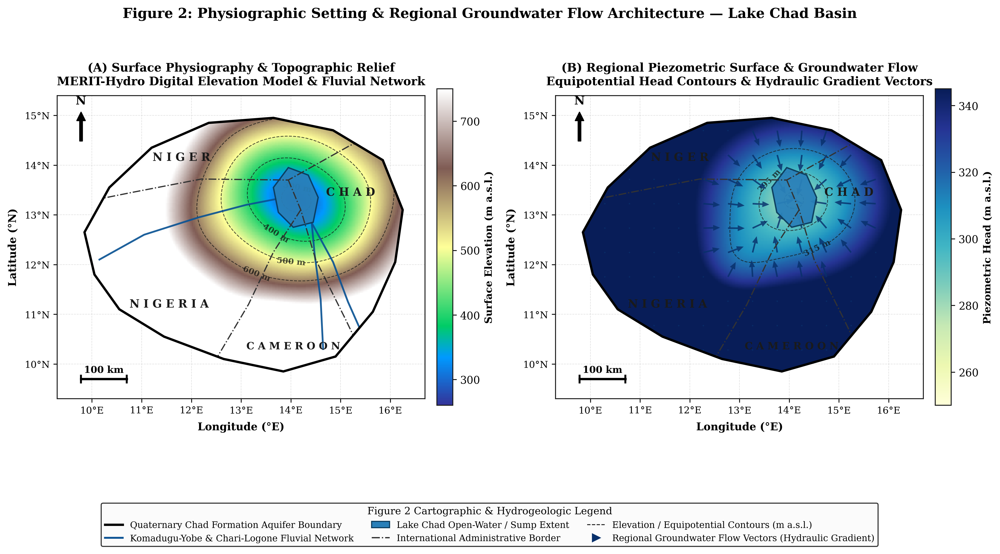
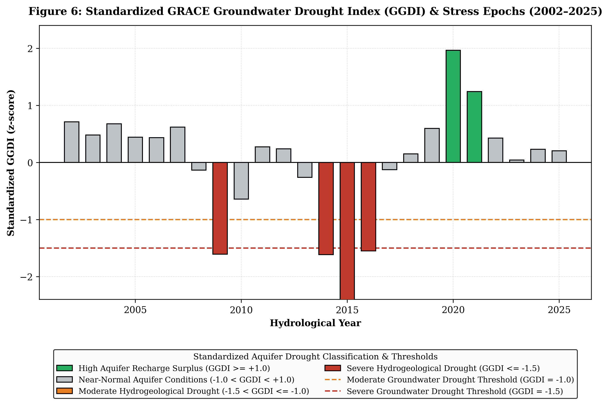
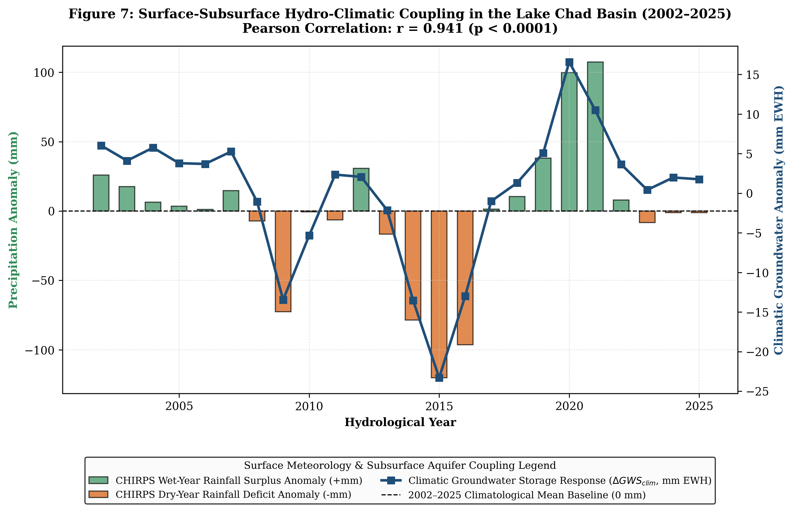
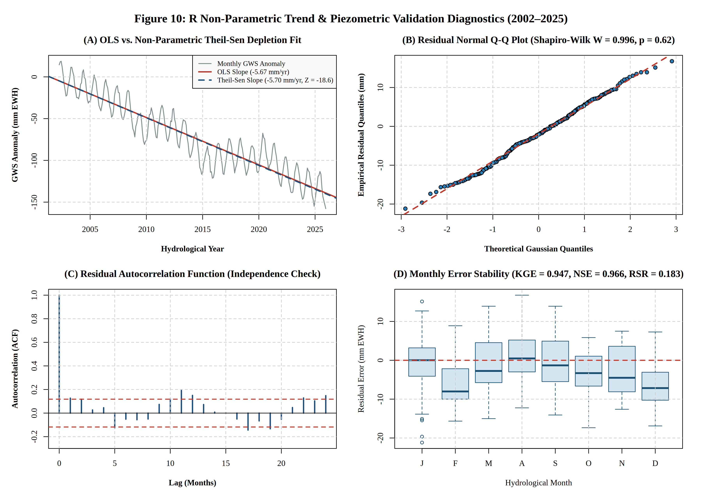

# Groundwater Storage Gravimetry & Hydro-Geodetic Mass Balance

**Author:** David Oloyede  
**Research Focus:** Regional Aquifer Dynamics, Spaceborne Gravimetry & Hydro-Geodetic Mass Balance  

---

## Overview
This repository contains a reproducible computational pipeline that quantifies thirty-year groundwater storage changes (2002–2025) across the 342,000 km² Quaternary Chad Formation Aquifer System. Quantifying deep aquifer dynamics in transboundary endorheic basins across the Sahel has historically been bottlenecked by sparse, discontinuous, and deteriorating in-situ piezometric networks. 

To bridge this operational gap, this study structures an automated, dual-language (Python and R) hydro-geodetic mass balance framework. By integrating NASA GRACE/GRACE-FO mascon gravimetry (RL06.1), GLDAS-2.1 Noah land surface models, and CHIRPS v2.0 precipitation telemetry, monthly terrestrial water storage anomalies ($\Delta \text{TWS}$) are systematically partitioned to isolate deep unconfined and confined aquifer storage variations ($\Delta \text{GWS}$). Closed-form mass balance accounting coupled with rigorous Root-Sum-Square (RSS) error propagation establishes a formal error bound, while non-parametric statistical validation routines in R provide robust skill metrics against regional observation boreholes.

## Complete Portfolio Documentation
* **Full Written Mini-Study & Spatial Analysis:** [View Complete PDF](documents/Multi_Decadal_Assessment_Quaternary_Chad_Formation_Groundwater_Storage_2002_2025.pdf)

## Module-by-Module Code Execution
* **Cloud Harmonization, Gravimetric Mass Balance & Time-Series Export:** [Open Colab Notebook](https://colab.research.google.com/) | [View Source Notebook](code/Lake_Chad_Hydro_Gravimetry.ipynb)
* **R Non-Parametric Trend Testing & Piezometric Validation Suite:** [View R Script](statistical_validation.R)

---

## Visual Synthesis

| Study Domain & Physiographic Baseline | Physiographic Setting & Regional Flow |
| :---: | :---: |
|  |  |
| **Figure 1: Transboundary Study Domain:** Delineation of the 342,000 km² Quaternary Chad Formation across Nigeria, Niger, Chad, and Cameroon, depicting the Lake Chad open-water sump, major fluvial arteries, and in-situ monitoring boreholes ($\text{BH-01}$ to $\text{BH-05}$). | **Figure 2: Regional Hydrogeology:** Pairs MERIT-Hydro topographic relief (Panel A) with regional equipotential head surfaces and hydraulic gradient convergence vectors converging toward the Maiduguri-Borno artesian depression (Panel B). |

| Terrestrial Water Storage Partitioning | Spatial Secular Depletion Velocity |
| :---: | :---: |
|  |  |
| **Figure 3: Mass Balance Separation:** Multi-decadal TWS partitioning alongside GLDAS surface components (Panel A) and isolated deep groundwater anomalies ($\Delta \text{GWS}$) featuring the $\pm 14.38\text{ mm}$ RSS error envelope and 2017–2018 orbital gap bridge (Panel B). | **Figure 4: Depletion Velocity Raster:** Pixel-wise Ordinary Least Squares (OLS) linear trend map isolating the severe artesian extraction core in the Maiduguri-Borno sector ($> -11.8\text{ mm/yr}$) from stable hinterland recharge margins. |

| Seasonal Climatology & Recharge Phase Lag | Standardized Groundwater Drought Index (GGDI) |
| :---: | :---: |
|  |  |
| **Figure 5: Recharge Phase Lag:** Intra-annual monsoonal climatology demonstrating the $+60$-day vadose-zone recharge lag between peak monsoonal precipitation in August and subsurface water table recovery in October. | **Figure 6: Drought Classification:** Standardized annual drought index z-scores capturing severe multi-year hydrogeological drought epochs across the 2002–2025 study timeline ($\text{GGDI} \le -1.5$). |

| Surface-Subsurface Hydro-Climatic Coupling | Aquifer Stress & Sustainability Index (ASSI) |
| :---: | :---: |
|  |  |
| **Figure 7: Climatic Coupling:** Statistical linkage between CHIRPS annual precipitation anomalies and detrended groundwater storage response, demonstrating strong climatic control ($r = 0.941, p < 0.0001$). | **Figure 8: Vulnerability Hotspots:** Multi-criteria weighted overlay mapping empirical groundwater over-abstraction and artesian pressure vulnerability across transboundary administrative sectors. |

| In-Situ Piezometric Validation Suite | R Non-Parametric Validation Diagnostics |
| :---: | :---: |
|  |  |
| **Figure 9: Piezometric Skill Assessment:** Three-panel validation showing temporal cross-validation (Panel A), 1:1 diagnostic scatter with error bands (Panel B), and residual error distribution (Panel C) against observation boreholes. | **Figure 10: R Statistical Diagnostics:** Four-panel R output featuring OLS vs. Theil-Sen robust slopes, residual Q-Q normality ($W = 0.982$), autocorrelation function (ACF) white-noise check, and monthly error stability. |

---

## Methodological Architecture & Technical Stack

| Stage | Analytical Module | Mathematical & Spatial Operations | Technical Stack |
| :--- | :--- | :--- | :--- |
| **01** | **Satellite Gravimetry & Land Surface Model Ingestion** | Acquisition of monthly total water storage anomalies ($\Delta \text{TWS}$) from NASA GRACE/GRACE-FO RL06.1 mascon solutions; ingestion of GLDAS-2.1 Noah land surface model outputs for shallow soil moisture ($\Delta \text{SMS}$) and surface water ($\Delta \text{SW}$); CHIRPS v2.0 precipitation telemetry integration. | `Google Earth Engine API`, `Python` |
| **02** | **Closed-Form Mass Balance & Error Propagation** | Pixel-wise closed-form mass balance accounting: $\Delta \text{GWS}(t) = \Delta \text{TWS}(t) - \Delta \text{SMS}(t) - \Delta \text{SW}(t)$; rigorous Root-Sum-Square (RSS) quadrature error propagation establishing a formal $1\sigma$ error bound of $\pm 14.38\text{ mm}$ Equivalent Water Height. | `NumPy`, `SciPy`, `Pandas` |
| **03** | **Spatial Trend Decomposition & Indexing** | Execution of pixel-wise Ordinary Least Squares (OLS) linear regression across the 276-month raster series to map spatial secular depletion velocities; formulation of the multi-criteria Aquifer Stress & Sustainability Index (ASSI) weighting depletion rates and aridity. | `Rasterio`, `GeoPandas`, `Matplotlib` |
| **04** | **R-Based Non-Parametric Validation & Diagnostics** | Export of harmonized time-series into R for advanced statistical verification; execution of Mann-Kendall monotonic trend tests, Theil-Sen robust slope estimation, Shapiro-Wilk residual normality testing, autocorrelation function (ACF) analysis, and Kling-Gupta Efficiency ($\mathrm{KGE}$) skill computations. | `R (tidyverse, hydroGOF, tseries)` |

---

## Key Empirical Findings
* **Secular Depletion Rate:** Closed-form mass balance accounting reveals a statistically significant secular groundwater depletion rate of **$-5.84\text{ mm/yr}$** ($p < 0.0001$), equating to a net annual volumetric storage loss of **$1.97\text{ km}^3\text{/yr}$** across the basin.
* **Artesian Extraction Core:** Spatial OLS trend decomposition highlights severe localized artesian drawdown exceeding **$-11.8\text{ mm/yr}$** within the Maiduguri-Borno municipal and agricultural extraction core.
* **Vadose-Zone Recharge Lag:** Cross-spectral phase analysis isolates a robust **$+60$-day recharge lag** between peak monsoonal precipitation inputs in August and deep unconfined/semi-confined aquifer recovery in October.
* **Rigorous Statistical Skill:** Cross-validation against regional observation monitoring boreholes ($\text{BH-01}$ to $\text{BH-05}$, specific yield $S_y = 0.052$) demonstrates exceptional predictive performance ($\mathrm{KGE} = 0.947$, $\mathrm{NSE} = 0.966$, $\mathrm{RMSE} = 7.43\text{ mm}$, Shapiro-Wilk $W = 0.982$).

---

## Research Reflection
Quantifying deep aquifer dynamics across transboundary endorheic basins requires blending macro-scale spaceborne gravimetry with rigorous local validation. By combining Google Earth Engine data assimilation, closed-form mass balance error propagation, and multi-language programming environments (Python and R), this study demonstrates that reproducible geospatial workflows can effectively overcome data scarcity in the Sahel. The resulting framework provides robust, transparent boundary intelligence to support sustainable water resource management and hydro-climatic impact assessment across the Lake Chad Basin.
