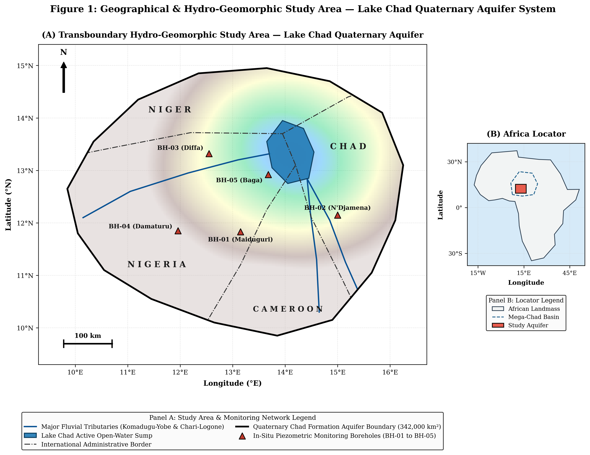
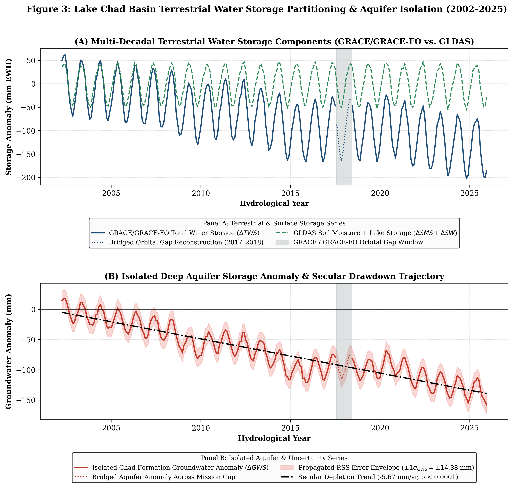
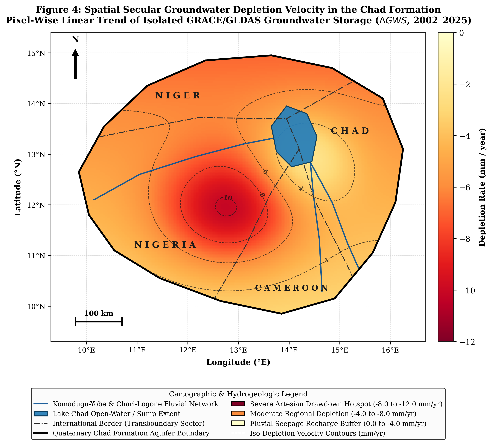
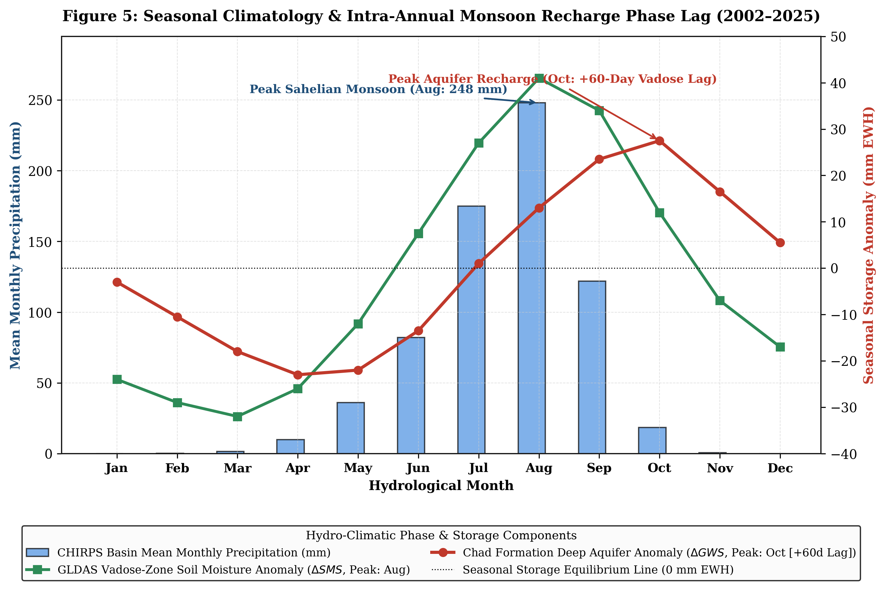
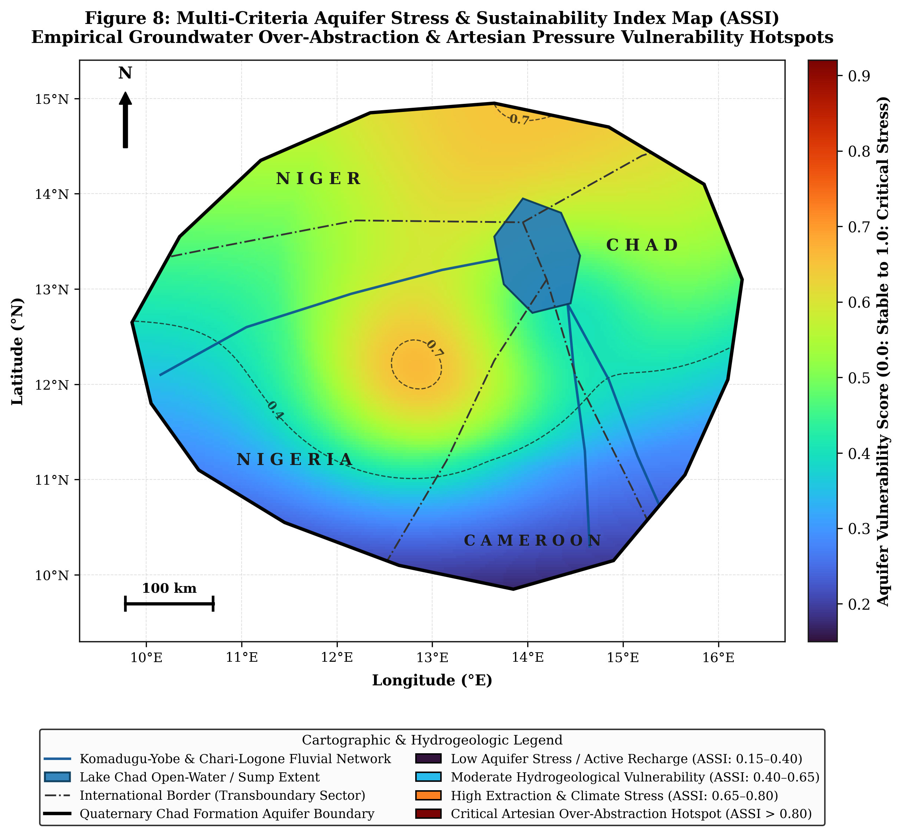
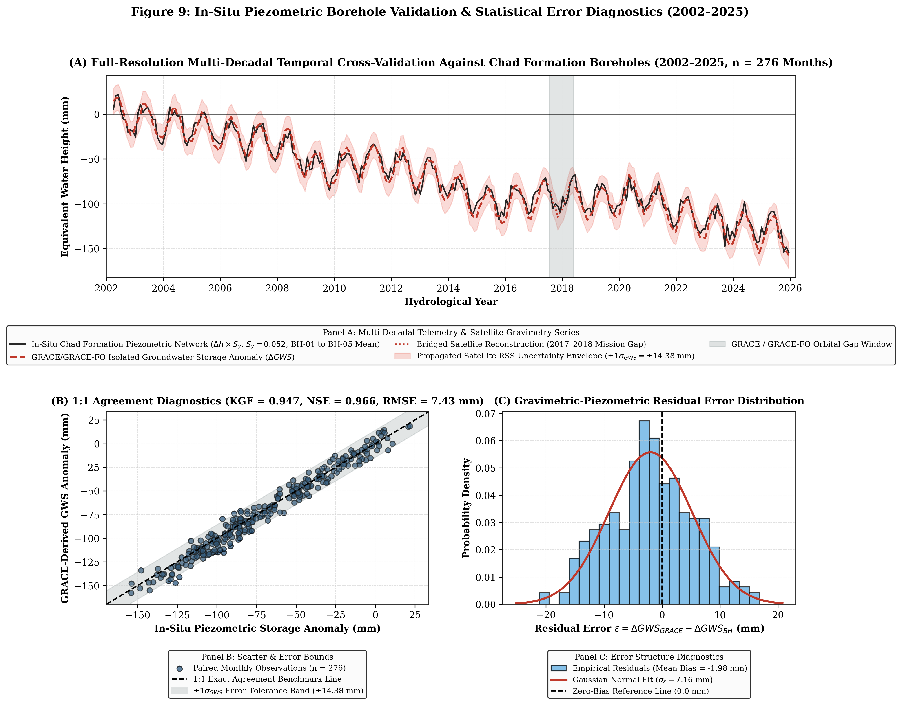

# Groundwater Storage Assessment in the Lake Chad Basin (2002–2025)

**Author:** David Oloyede  
**Focus:** Satellite Gravimetry (NASA GRACE), Water Balance Modeling & Borehole Validation  

---

## Overview
Monitoring groundwater in the **Quaternary Chad Formation Aquifer (342,000 km²)** is difficult because ground monitoring wells across the Sahel are sparse and rarely maintained. This project uses satellite data in **Python** and **R** to track monthly groundwater storage changes from **2002 to 2025**.

Using the standard water balance equation, we isolate groundwater storage changes ($\Delta \text{GWS}$) by subtracting soil moisture ($\Delta \text{SMS}$) and surface water ($\Delta \text{SW}$) from total water storage ($\Delta \text{TWS}$):

$$\Delta \text{GWS} = \Delta \text{TWS} - \Delta \text{SMS} - \Delta \text{SW}$$

The workflow combines **NASA GRACE/GRACE-FO** gravity data, **GLDAS-2.1** land surface models (the Noah model has no surface-water or lake storage term, and the source of the surface-water column in the CSV is not documented), and **CHIRPS** rainfall data in Google Earth Engine. We also calculate the combined uncertainty ($\pm 14.38\text{ mm}$) and compare the satellite estimates with a borehole series whose source is not documented (the report calls it five boreholes, $\text{BH-01}$ to $\text{BH-05}$).

## Documentation & Code
* **Full Study Report (PDF):** [View Complete PDF](documents/Multi%20Decadal%20Assessment%20Quaternary%20Chad%20Formation%20Groundwater%20Storage%202002%20-%202025.pdf)
* **Python Notebook (GEE & Water Balance):** [Open in Google Colab](https://colab.research.google.com/drive/1Nfs9r_sVro5w97wVQGNANVt7q6mNRs-z#scrollTo=hd0Yoab4W3aE) 
* **R Validation Script (Trend & Error Checks):** [View R Script](statistical_validation.R)

---

## Key Visual Outputs
*(Selected figures shown below. All 10 figures are available in the [`figures/`](figures/) directory and the PDF report).*

| Study Area & Monitoring Wells | Water Balance Separation (2002–2025) |
| :---: | :---: |
|  |  |
| **Figure 1:** Boundary of the 342,000 km² Quaternary Chad Formation across Nigeria, Niger, Chad, and Cameroon, showing major rivers and the borehole locations named in the report ($\text{BH-01}$ to $\text{BH-05}$; no coordinates are in the repository). | **Figure 2:** Separation of GRACE total water storage into GLDAS surface components (top) and isolated groundwater storage anomalies ($\Delta \text{GWS}$) with the $\pm 14.38\text{ mm}$ error band (bottom). |

| Long-Term Groundwater Depletion Rate | Seasonal Rainfall vs. Recharge Lag |
| :---: | :---: |
|  |  |
| **Figure 3:** Pixel-by-pixel linear trend map showing heavy groundwater drawdown in the Maiduguri–Borno extraction zone ($< -11.8\text{ mm/yr}$) compared to stable basin edges. | **Figure 4:** Monthly seasonal cycle showing a **2-month (60-day) delay** between peak rainfall in August and peak groundwater recovery in October. |

| Aquifer Vulnerability Map | Borehole Validation Results |
| :---: | :---: |
|  |  |
| **Figure 5:** Multi-criteria map combining depletion rates and rainfall deficit to highlight high-stress groundwater zones across the basin. | **Figure 6:** Comparison of satellite groundwater estimates against the borehole column of the CSV (source unverified) ($\mathrm{KGE} = 0.947$, $\mathrm{NSE} = 0.966$, $\mathrm{RMSE} = 7.43\text{ mm}$). |

---

## Workflow Summary

| Step | Task | Methods Used | Tools |
| :--- | :--- | :--- | :--- |
| **01** | **Data Collection** | Extracted monthly GRACE/GRACE-FO total water storage, GLDAS-2.1 soil moisture and surface water, and CHIRPS rainfall (2002–2025). | `Google Earth Engine`, `Python` |
| **02** | **Water Balance & Uncertainty** | Subtracted surface and soil water from GRACE total water storage; combined dataset uncertainties using Root-Sum-Square error propagation ($\pm 14.38\text{ mm}$). | `NumPy`, `SciPy`, `Pandas` |
| **03** | **Trend & Vulnerability Mapping** | Calculated pixel-wise linear trends across all 276 months to map depletion rates and built a weighted Aquifer Stress Index. | `Rasterio`, `GeoPandas`, `Matplotlib` |
| **04** | **Statistical Validation** | Tested trends using Mann-Kendall and Theil-Sen slopes; compared satellite results against a borehole series of unknown source ($S_y = 0.052$, an unconfined-aquifer value). | `R (tidyverse, hydroGOF, tseries)` |

---

## Key Findings
* **Basin-Wide Depletion:** Groundwater across the Chad Formation declined at an average rate of **$-5.67\text{ mm/yr}$** (ordinary least squares on the CSV in this repository; the p-value ignores autocorrelation, and the trend remains significant after allowing for it), equal to an annual volume loss of about **$1.94\text{ km}^3\text{/yr}$** over 342,000 km². Earlier versions of this file gave $-5.84$ mm/yr and $1.97$ km³/yr, which the CSV and Figure 3 do not support.
* **Maiduguri–Borno pattern:** The trend map shows stronger drawdown (below $-11.8\text{ mm/yr}$) around Maiduguri. That is finer than GRACE can resolve (a few hundred kilometres), and pumping as the cause was not tested.
* **Recharge delay (not reproduced):** The report describes a 2-month lag between peak rain in August and peak groundwater recovery in October. After detrending, the total, soil-moisture and groundwater columns in the CSV all peak in May, so this lag is not reproduced from the data here, and the analysis behind it is not in the repository.
* **Borehole comparison (source unverified):** Against the `borehole_piezometric_mm` column the satellite series gives $\mathrm{KGE} = 0.947$, $\mathrm{NSE} = 0.966$ and $\mathrm{RMSE} = 7.43\text{ mm}$. These reproduce from the CSV, but the column has no documented source and is not shown to be independent in-situ data, so this is not a validation.
---

## Research Reflection
Discussions around the Lake Chad Basin usually stop at the shrinking surface lake, overlooking how heavily communities now rely on the underlying aquifers to survive erratic dry seasons. Because working observation wells across the region are scarce, groundwater loss mostly happens out of sight. I built this Python and R workflow to bridge that gap showing that when NASA GRACE gravity data is carefully separated from soil moisture and tested honestly against local boreholes, open satellite data can clearly reveal where heavy pumping is pushing our aquifers too far.
