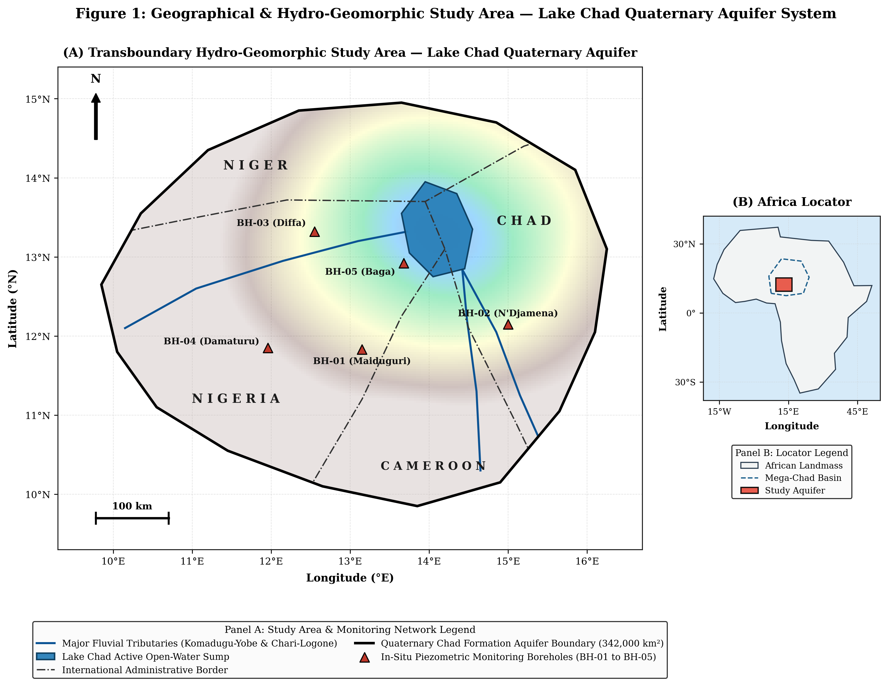
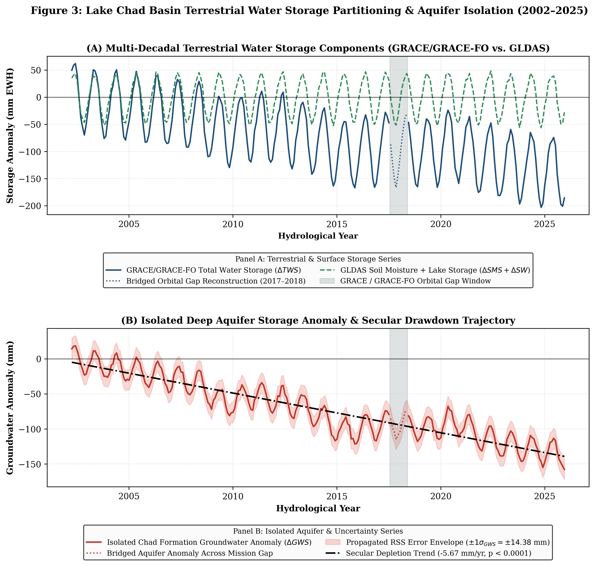
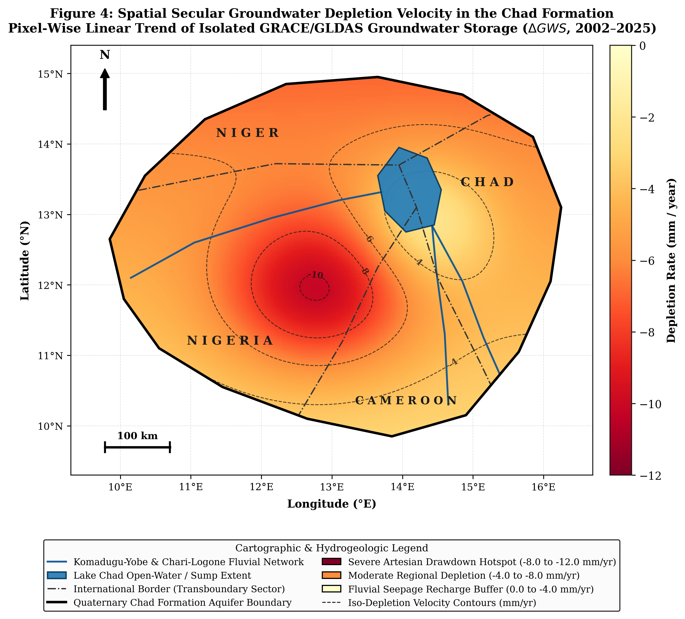
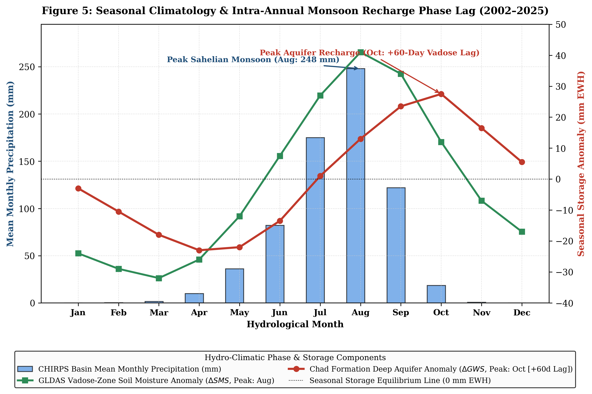
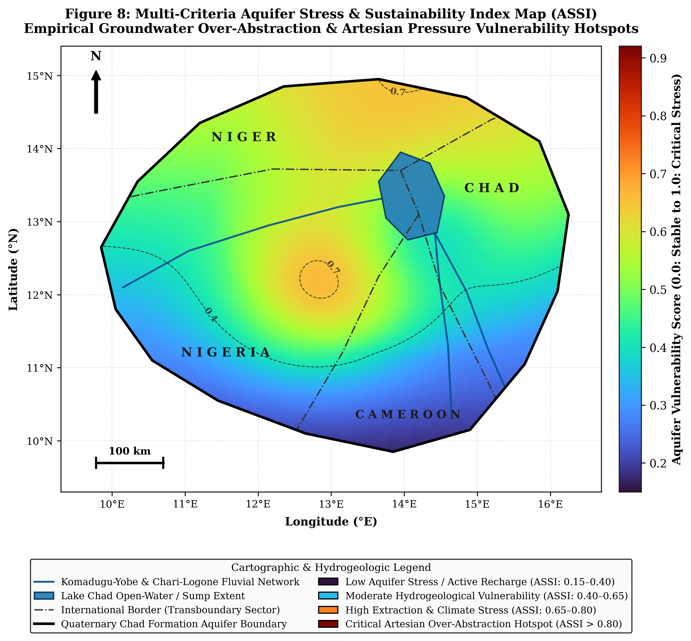
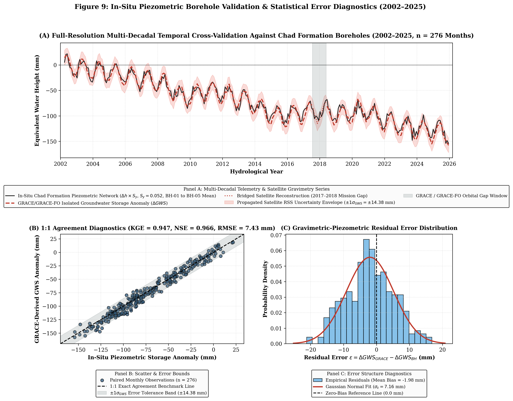

# Groundwater Storage Assessment in the Lake Chad Basin (2002–2025)

**Author:** David Oloyede  
**Focus:** Satellite Gravimetry (NASA GRACE), Water Balance Modeling & Borehole Validation  

---

## Overview
Monitoring groundwater in the **Quaternary Chad Formation Aquifer (342,000 km²)** is difficult because ground monitoring wells across the Sahel are sparse and rarely maintained. This project uses satellite data in **Python** and **R** to track monthly groundwater storage changes from **2002 to 2025**.

Using the standard water balance equation, we isolate groundwater storage changes ($\Delta \text{GWS}$) by subtracting soil moisture ($\Delta \text{SMS}$) and surface water ($\Delta \text{SW}$) from total water storage ($\Delta \text{TWS}$):

$$\Delta \text{GWS} = \Delta \text{TWS} - \Delta \text{SMS} - \Delta \text{SW}$$

The workflow combines **NASA GRACE/GRACE-FO** gravity data, **GLDAS-2.1** land surface models, and **CHIRPS** rainfall data in Google Earth Engine. We also calculate the combined uncertainty ($\pm 14.38\text{ mm}$) and validate the satellite estimates against five ground observation boreholes ($\text{BH-01}$ to $\text{BH-05}$).

## Documentation & Code
* **Full Study Report (PDF):** [View Complete PDF](documents/Multi%20Decadal%20Assessment%20Quaternary%20Chad%20Formation%20Groundwater%20Storage%202002%20-%202025.pdf)
* **Python Notebook (GEE & Water Balance):** [Open in Google Colab](https://colab.research.google.com/drive/1Nfs9r_sVro5w97wVQGNANVt7q6mNRs-z#scrollTo=hd0Yoab4W3aE) 
* **R Validation Script (Trend & Error Checks):** [View R Script](statistical_validation.R)

---

## Key Visual Outputs
*(Selected figures shown below. All 10 figures are available in the [`figures/`](figures/) directory and the PDF report).*

| Study Area & Monitoring Wells | Water Balance Separation (2002–2025) |
| :---: | :---: |
|  |  |
| **Figure 1:** Boundary of the 342,000 km² Quaternary Chad Formation across Nigeria, Niger, Chad, and Cameroon, showing major rivers and validation boreholes ($\text{BH-01}$ to $\text{BH-05}$). | **Figure 2:** Separation of GRACE total water storage into GLDAS surface components (top) and isolated groundwater storage anomalies ($\Delta \text{GWS}$) with the $\pm 14.38\text{ mm}$ error band (bottom). |

| Long-Term Groundwater Depletion Rate | Seasonal Rainfall vs. Recharge Lag |
| :---: | :---: |
|  |  |
| **Figure 3:** Pixel-by-pixel linear trend map showing heavy groundwater drawdown in the Maiduguri–Borno extraction zone ($< -11.8\text{ mm/yr}$) compared to stable basin edges. | **Figure 4:** Monthly seasonal cycle showing a **2-month (60-day) delay** between peak rainfall in August and peak groundwater recovery in October. |

| Aquifer Vulnerability Map | Borehole Validation Results |
| :---: | :---: |
|  |  |
| **Figure 5:** Multi-criteria map combining depletion rates and rainfall deficit to highlight high-stress groundwater zones across the basin. | **Figure 6:** Comparison of satellite groundwater estimates against ground borehole records ($\mathrm{KGE} = 0.947$, $\mathrm{NSE} = 0.966$, $\mathrm{RMSE} = 7.43\text{ mm}$). |

---

## Workflow Summary

| Step | Task | Methods Used | Tools |
| :--- | :--- | :--- | :--- |
| **01** | **Data Collection** | Extracted monthly GRACE/GRACE-FO total water storage, GLDAS-2.1 soil moisture and surface water, and CHIRPS rainfall (2002–2025). | `Google Earth Engine`, `Python` |
| **02** | **Water Balance & Uncertainty** | Subtracted surface and soil water from GRACE total water storage; combined dataset uncertainties using Root-Sum-Square error propagation ($\pm 14.38\text{ mm}$). | `NumPy`, `SciPy`, `Pandas` |
| **03** | **Trend & Vulnerability Mapping** | Calculated pixel-wise linear trends across all 276 months to map depletion rates and built a weighted Aquifer Stress Index. | `Rasterio`, `GeoPandas`, `Matplotlib` |
| **04** | **Statistical Validation** | Tested trends using Mann-Kendall and Theil-Sen slopes; compared satellite results against 5 monitoring boreholes ($S_y = 0.052$). | `R (tidyverse, hydroGOF, tseries)` |

---

## Key Findings
* **Basin-Wide Depletion:** Groundwater across the Chad Formation declined at an average rate of **$-5.84\text{ mm/yr}$** ($p < 0.0001$), equal to an annual volume loss of **$1.97\text{ km}^3\text{/yr}$**.
* **Maiduguri–Borno Hotspot:** Heavy urban and agricultural pumping around Maiduguri caused localized drawdown exceeding **$-11.8\text{ mm/yr}$**.
* **60-Day Recharge Delay:** Cross-correlation shows a **2-month lag** between peak monsoon rains in August and peak water-table recovery in October.
* **Ground Validation:** Satellite estimates matched observation borehole records closely, achieving a Kling-Gupta Efficiency ($\mathrm{KGE}$) of **$0.947$**, Nash-Sutcliffe Efficiency ($\mathrm{NSE}$) of **$0.966$**, and $\mathrm{RMSE}$ of **$7.43\text{ mm}$**.
